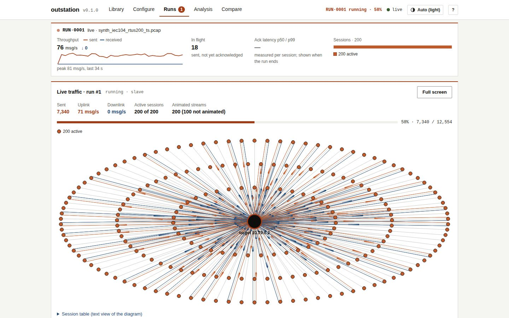
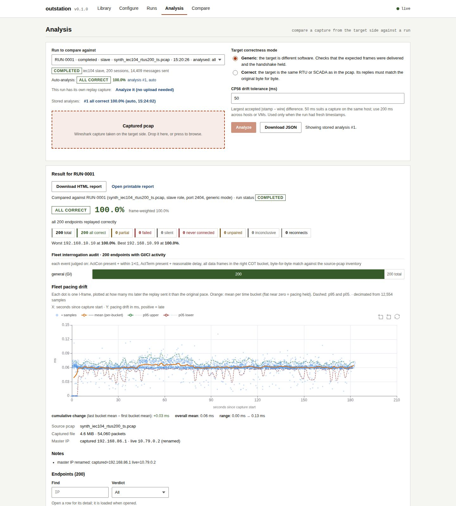
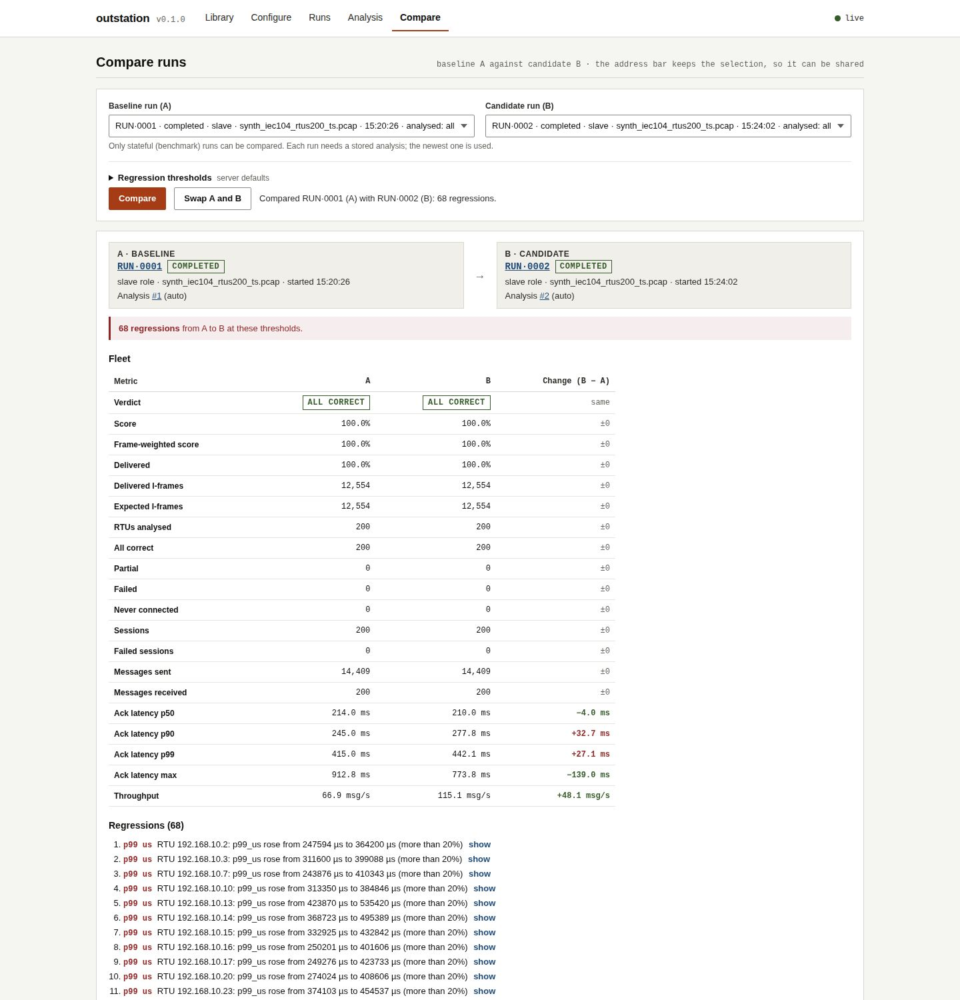
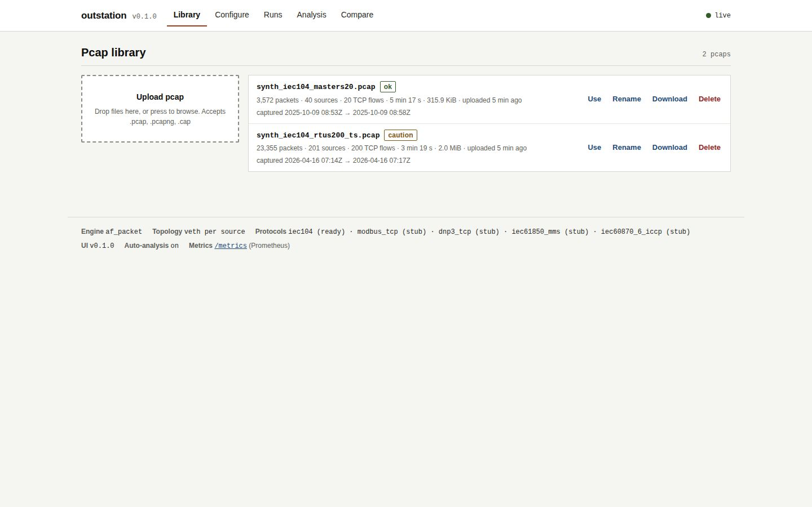
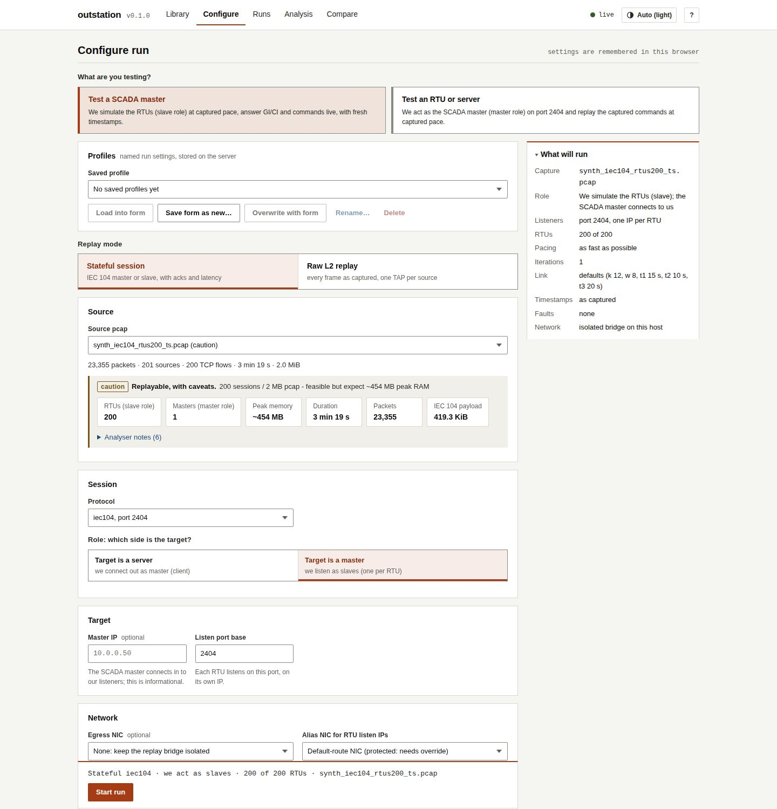
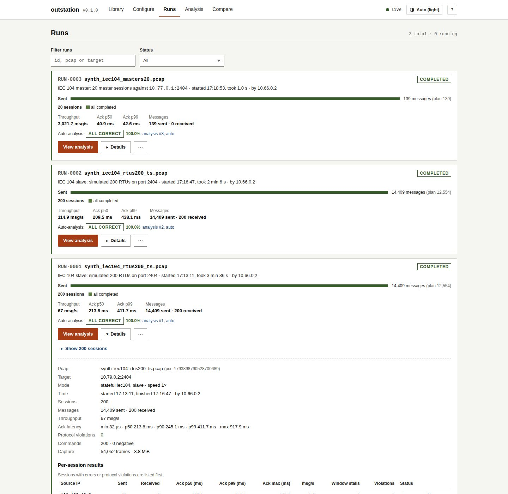

# outstation

[](#license)
[](https://www.rust-lang.org)
[](#requirements)

A stateful SCADA traffic simulator for Linux. It replays captured IEC 60870-5-104 traces as live TCP sessions on the wire, one session per captured RTU or master, measures per-message latency, and checks afterwards how faithfully the replay matched the capture. It is built for benchmarking and regression-testing SCADA systems with real captured traffic.

You drive it from a browser UI (upload a pcap, configure a run, watch it live, read the analysis) or headless from the command line with `outstation bench`, which runs one benchmark, checks assertions and exits non-zero on failure, for CI.

---

## Contents

- [Why](#why)
- [What makes it different](#what-makes-it-different)
- [How it works](#how-it-works)
- [Features](#features)
- [Screenshots](#screenshots)
- [Protocol support](#protocol-support)
- [IEC 104 conformance](#iec-104-conformance)
- [Scale](#scale)
- [Quick start](#quick-start)
- [Headless benchmarks for CI](#headless-benchmarks-for-ci)
- [Generating synthetic IEC 104 pcaps](#generating-synthetic-iec-104-pcaps)
- [Documentation](#documentation)
- [Crate layout](#crate-layout)
- [Requirements](#requirements)
- [Safety](#safety)
- [License](#license)

---

## Why

Running realistic traffic against a SCADA system is harder than it sounds. You can capture a pcap from production with traffic from 200 RTUs, but you can't just `tcpreplay` it. The SCADA master has a whitelist of real RTU IPs and expects real TCP sessions. The captured flows have to be reassembled per RTU and driven through the IEC 60870-5-104 state machine (STARTDT, k-window, I-frames, S-frame acks, TESTFR). And you need per-message latency measurements to tell whether the system under test keeps up.

outstation does this from a single binary, and it is designed to run against a SCADA test system **without changing anything inside it** (see the [SCADA lab guide](doc/scada-lab.en.md)).

## What makes it different

Most pcap replay tools treat a capture as bytes to retransmit. outstation treats a capture as *behaviour to impersonate*. `tcpreplay` streams L2 packets at an interface with optional address rewrite; `tcpliveplay` drives exactly one live TCP flow without application-layer knowledge; Scapy scripts and `bittwist` work one flow at a time. None of them stand in for 200 RTUs, measure per-message latency under load, or tell you afterwards whether the replay was faithful.

- **Protocol participant, not a packet blaster.** In benchmark mode outstation opens real TCP sessions and runs the IEC 104 link layer: APCI framing, live N(S)/N(R), k/w windows, t1/t2/t3 timers, STARTDT/STOPDT and TESTFR (see [conformance](#iec-104-conformance)). The live peer gets a counterpart it can talk to.
- **Both sides, many sessions, one host.** Play the RTUs (slave role, for testing a SCADA master) or the master (master role, for testing an RTU or front end). One run impersonates many endpoints (800 RTUs in the largest measured run, see [Scale](#scale)) on standard port 2404, told apart only by IP. Slave role adds and removes /32 aliases for the RTU IPs; master role builds one veth port per session on a private bridge, so each session binds its captured source address.
- **A replayed RTU that answers.** In slave role the replayer answers the live master's General and Counter Interrogations from a point inventory learned from the capture, echoes control commands (select/execute, set-points, clock sync, read) with confirmations and optional return information, and keeps serving after the script ends.
- **Built-in fidelity analysis.** After a run the analyzer compares the run's own capture against the source pcap endpoint by endpoint: delivered vs expected frames aligned by content, byte-identical counts, time-tag drift, pacing drift, a GI/CI compliance audit and a verdict per RTU and for the fleet. Runs are analysed automatically and can be compared run against run.
- **Timing-preserving pacing.** Original-timing pacing sends each I-frame at its captured offset (scaled by a speed factor), so the shape of the telemetry feed survives: the pauses, the bursts, the outliers. As-fast-as-possible pacing is there for throughput tests.
- **Fault injection.** Withhold acks, drop, duplicate or delay I-frames, corrupt N(S), go silent on TESTFR, send STOPDT, malformed APDUs or an RST at a chosen time or frame, and see how the peer reacts.
- **Benchmark metrics.** Per-session send→ack latency (p50/p90/p99/max; p50/p99 also live on the Runs page while a run goes) together with the peer's ack cadence (full window, t2 timer or piggybacked, so you can tell what the latency reflects), window stalls, throughput and byte counts, plus how fast the replayed RTUs answered the master's commands.

## How it works

```
                         ┌──────────────────────────────────────┐
  browser UI, curl ───▶  │  webui crate  (axum + embedded SPA)  │ ◀── outstation bench
                         │  ─ pcap library, run requests        │     (same code path)
                         │  ─ live progress (WebSocket, SSE)    │
                         │  ─ analysis, compare, profiles       │
                         │  ─ SQLite history, /metrics          │
                         └────────────────┬─────────────────────┘
                                          ▼
┌─────────────────────────────────────────────────────────────────┐
│              sched crate  (orchestrator + RunContext)           │
│   run(): raw replay             │   run_benchmark(): sessions   │
│   ─ one bridge port per source  │   ─ master: veth per session  │
│   ─ AF_PACKET injection         │   ─ slave: listener per RTU   │
│   ─ shared-epoch pacing         │   ─ capture of the run        │
└──────────┬──────────────────────────────┬──────────────────────┘
           ▼                              ▼
   ┌──────────────┐                ┌──────────────────┐
   │ raw_replay   │                │ proto_iec104     │
   │ + rewrite    │                │ link engine,     │
   │ + pcapload   │                │ responder,       │
   └──────┬───────┘                │ analyzer         │
          │                        └─────────┬────────┘
          └──────────────┬───────────────────┘
                         ▼
                  ┌───────────────┐
                  │ netctl crate  │  bridges, veths, IP aliases, NIC protection,
                  │               │  host isolation, journaled guards, cleanup
                  └───────┬───────┘
                          ▼
              Linux (AF_PACKET, veth, bridge, tc, iptables)
```

Every host change a run makes is journaled before it is made and undone when the run ends. A crash, a SIGKILL or a power cut leaves the journal behind, and the next start, `outstation cleanup` or the systemd unit's `ExecStopPost` replays it ([operations](doc/operations.md#host-changes-and-cleanup)).

## Features

**Replay modes**

- **Raw replay.** Each captured source gets its own bridge port; its frames are injected via AF_PACKET with source addresses kept, destination rewritten and checksums recomputed. For feeding IDS, loggers and historians.
- **Stateful sessions (benchmark mode)**, in two roles:
  - **Slave** (test a SCADA master): one listener per captured RTU on the RTU's own IP and port 2404. IPs that are not local are added as `/32 noprefixroute` aliases on a NIC you choose (`alias_iface`). Listeners wait until you arm them, all at once (**Start all pending**) or one by one, and you can change a listen IP before it starts.
  - **Master** (test an RTU or front end): one TCP client session per captured master, each bound to its captured source IP on a veth port of a private bridge, which can enslave an egress NIC.

**IEC 104 behaviour** ([reference](doc/iec104-config.md))

- Configurable k, w, t0–t3 and the slave's idle-serve window.
- Live GI/CI answers in slave role, built from the capture; captured interrogation bursts are left out of the script so the master gets no stale answers.
- Command echo in slave role: ActCon, ActTerm, DeactCon, negative confirmations with the right COT, optional return information that updates later GI answers.
- CA, COT and IOA rewrite maps; CP56Time2a rewritten to the send time in local or UTC.
- Fault injection with a seeded, reproducible plan.
- Loops: `iterations` passes (0 = until stopped), as reconnects or inside one session.
- Pre-run RTU picker: choose a subset of the RTUs (or masters) in the capture.

**After the run**

- **Auto-analysis** of every finished benchmark run's capture (slave and master role), stored with the run. Upload your own target-side capture for a second opinion.
- **Compare** two runs: fleet and per-RTU deltas in score, delivered frames, latency and throughput, with regression flags and thresholds.
- **Re-run** a run with its stored request, and save named **profiles**.
- Download the capture, or a self-contained printable HTML report of any analysis; inter-frame gap histograms (source vs replay); per-session latency histograms.

**Operations**

- Single-run lock: a second start gets 409 naming who started the active run, and every open UI shows a banner while someone else's run is active.
- `GET /api/status` health with degraded reasons, and Prometheus `GET /metrics`.
- SQLite history with schema migrations; captures under the state directory with a per-run size cap and total size and count caps.
- State-directory lock: a second `serve`, an `outstation bench` or a plain `outstation cleanup` on the same state directory refuses while a server runs (`cleanup --force` overrides).
- Graceful SIGTERM: runs are stopped and host changes undone before exit.

The UI covers the whole lifecycle: library, configure (with saved profiles), runs (re-run, load settings back into the form, live auto-analysis state), analysis and run-to-run compare. Everything is also available through the [HTTP API](doc/api.md) and the `bench` CLI.

## Screenshots

Taken from a real `outstation serve` with real runs ([`scripts/netns-screenshots.sh`](scripts/netns-screenshots.sh)): the 200-RTU example capture in slave role, at original timing, against a master peer.

**Runs**: a 200-RTU slave run while it is live, every session active and both directions animated.



**Analysis**: the same run's automatic analysis, `all_correct` for all 200 RTUs, with the GI audit and the pacing drift.



**Compare**: that run against a re-run at twice the speed, fleet deltas and per-RTU regressions.



<details>
<summary>Library, Configure and the finished run</summary>







</details>

## Protocol support

| Protocol | Crate | Status |
|---|---|---|
| IEC 60870-5-104 | `proto_iec104` | **ready** |
| Modbus/TCP | `proto_modbus_tcp` | stub |
| DNP3 over TCP | `proto_dnp3_tcp` | stub |
| IEC 61850 MMS | `proto_iec61850_mms` | stub |
| IEC 60870-6 ICCP | `proto_iec60870_6_iccp` | stub |

Stub protocols are listed but cannot run benchmarks. New protocols implement the `ProtoReplayer` trait; the scheduler, the run pipeline and the analysis shell are protocol-agnostic, but a few places in the web UI still assume IEC 104 ([adding a protocol](doc/adding-a-protocol.md)).

## IEC 104 conformance

What the link engine ([`link.rs`](crates/proto_iec104/src/link.rs)) does, in both roles. Details and every setting are in the [IEC 104 reference](doc/iec104-config.md).

| Item | Behaviour | Default |
|---|---|---|
| **k** | At most k unacknowledged I-frames in flight; sending waits for an ack | 12 |
| **w** | S-frame at the latest after w received I-frames | 8 |
| **t0** | Master role: TCP connect timeout | 5 s unless set (IEC default 30 s) |
| **t1** | An I-frame, STARTDT/STOPDT act or TESTFR act not acknowledged or confirmed in t1 closes the connection | 15 s |
| **t2** | Received I-frames acknowledged at the latest t2 after the first unacknowledged one; t2 < t1 is enforced | 10 s |
| **t3** | TESTFR act after t3 without receiving anything; TESTFR act from the peer is answered | 20 s |
| **STARTDT / STOPDT** | Master: STARTDT act → con before data, S-frame flush and STOPDT act → con at the end. Slave: confirms STARTDT; confirms a mid-session STOPDT once its I-frames are acknowledged and stops sending until the next STARTDT | |
| **Sequence numbers** | Live N(S)/N(R) mod 2^15. Received N(S) is checked against V(R) and N(R) against the unacknowledged window; a violation is recorded and closes the connection | |
| **Framing** | Strict APDU reader: bad start octet, length or control field is a violation | |
| **Teardown** | Every exit sends FIN and joins the reader | |

The peer's violations and timer expiries are recorded per session (`ns_mismatch`, `nr_out_of_window`, `malformed_frame`, `unexpected_u_frame`, `t1_timeout`).

Not implemented: IEC 62351 security (TLS, authentication), Edition 2 redundancy groups and automatic reconnects, non-standard ASDU field sizes, IPv6, and in master role answering commands or interrogations (the captured master traffic is replayed and the slave's confirmations measured). The post-run analyzer checks content, time tags, pacing, the STARTDT handshake and GI/CI answers; it does not judge the peer's t1/t2/t3 timing from the capture.

### Which tests it fits

| Test | Fit | Why |
|---|---|---|
| Functional and data flow: does the master get the right type IDs, COTs, addresses, values, in order? | Good | Replayed I-frames are byte-identical outside CP56 time tags, and the analyzer verifies it per RTU |
| Load: can the master handle N concurrent RTUs at captured rates? | Good, within the [measured scale](#scale) | Real sessions, real flow control, per-session latency |
| Interoperability of the link layer | Good for the items in the table above | |
| Event time stamps | Good when both hosts are NTP-synced | CP56 can be rewritten to the send time; accuracy is bounded by the clock difference between hosts |
| Interrogation and command handling of the master | Good | Live GI/CI and command echo, with an audit |
| Failure handling of the peer | Good for the [fault kinds](doc/iec104-config.md#faults-and-fault_seed-fault-injection) | |
| Closed-loop control (a command changes process state that feeds back) | Limited | Return information reflects the commanded value; there is no process model behind it |
| IEC 62351 security | Out of scope | |

## Scale

Measured on one 12-thread desktop (Ryzen 5 3600, 64 GB RAM, Linux 7.0) with outstation, its IEC 104 peers and the network all in namespaces on the same host; medians of 3 runs, as fast as possible ([report](reports/2026-11-05-scale-benchmark.md), [`scripts/netns-scale.sh`](scripts/netns-scale.sh)):

| | master role, 200 sessions | master, 400 | slave role, 200 RTUs | slave, 400 RTUs |
|---|---|---|---|---|
| I-frames/s | 716 k | 657 k | 324 k | 265 k |
| ack latency p50 / p99 | 2.3 / 6.0 ms | 4.3 / 7.1 ms | 0.4 / 2.3 ms | 0.4 / 2.2 ms |
| outstation CPU while sending | 4.4 cores | 4.6 cores | 2.0 cores | 2.0 cores |
| RSS while sending / peak with the analysis | 267 / 571 MB | 451 / 1,138 MB | 172 / 600 MB | 278 / 1,153 MB |
| setup before traffic / teardown | 0.8 s / 0.9 s | 1.5 s / 1.7 s | 6 s / – | 12 s / – |
| fidelity verdict, frames lost by the capture | `all_correct` 100, 0 | `all_correct` 100, 0 | `all_correct` 100, 0 | `all_correct` 100, 0 |

- **Fidelity verdicts hold at full speed.** Every full-speed run of 200 and 400 sessions, in both roles, scores `all_correct`, and the capture lost no frames: it merges its sources by kernel timestamp, reads through a TPACKET_V3 ring and runs at RT priority whenever allowed. If a capture does lose frames, `captured_dropped`, the analysis notes and `run_warning` say so.
- **CPU follows the message rate, not the number of sessions**: about 6-9 µs per I-frame at full speed; 200 RTUs at 10× their captured pace (9,000 I-frames/s) use a third of a core. The 165-RTU production capture of the [April report](reports/2026-04-17-fleet-replay-showcase.md) ran at about 680 I-frames/s.
- **Memory**: about 0.5-1 MB per session while sending (including 32 MiB of receive ring per capture socket), plus the loaded capture (roughly its file size). The automatic analysis needs 2-5 times that for a few seconds after the run.
- **Setup runs in parallel**: in master role about 3 ms per session (veth ports built by up to 8 workers, one iptables transaction, one `tc -batch`), teardown 1-2 s; in slave role 30-45 ms per listener (alias, journal entry, capture filter update), overlapping with traffic.
- **800 sessions**: slave role runs (800 of 800). In master role the test host's kernel neighbour table overflowed (both ends shared one kernel); outstation's host needs one neighbour entry per master session, so above about 1,000 sessions raise `net.ipv4.neigh.default.gc_thresh3`.
- Each session holds about 2 (master) to 4 (slave) file descriptors; outstation raises its soft open-file limit to the hard limit at startup.
- SCADA-gateway mode is for slave role; master-role runs refuse it.

## Quick start

```sh
# Build (Rust 1.85 or newer)
cargo build --release -p outstation

# Try it locally. Runs need CAP_NET_ADMIN and CAP_NET_RAW; sudo gives both.
sudo ./target/release/outstation serve          # binds 127.0.0.1:8080
xdg-open http://127.0.0.1:8080
```

For a lab host, install the systemd unit, which runs as an unprivileged user with ambient capabilities and keeps its data in `/var/lib/outstation`:

```sh
sudo ./systemd/install.sh
```

The unit binds `0.0.0.0:8080` for LAN access, **without authentication**: read [Safety](#safety) first. [Operations](doc/operations.md) covers the unit, configuration, the state directory and troubleshooting.

### First run

1. **Library**: drop in a pcap or pcapng. The background parse reports packets, RTUs, flows and a viability verdict.
2. **Configure**: pick the pcap and the role.
   - Testing a SCADA master: *Target is a master* (slave role). Choose the **Alias NIC** that faces the master; RTU IPs that are not local are aliased there.
   - Testing an RTU or server: *Target is a server* (master role). Enter the target IP and the **Egress NIC** that leads to it.
3. Pick pacing (*as fast as possible* for throughput, *original pcap timing* for realism), optionally a subset of RTUs, and IEC 104 options.
4. **Start run**. In slave role, press **Start all pending** on the run card (or start listeners one by one), then let the master connect to the RTU IPs on port 2404.
5. **Runs** shows live progress per session and, under **Details**, latency per session. **Analysis** lists the run's stored analyses, including the automatic one, and shows the per-RTU drill-down.

The [SCADA lab guide](doc/scada-lab.en.md) walks through both scenarios, including SCADA-gateway mode (slave role only) for a master on another subnet.

## Headless benchmarks for CI

`outstation bench` runs one benchmark through the same code as the web UI, analyses its own capture, checks assertions and writes a JSON report.

```sh
sudo outstation bench --pcap fleet.pcap --profile run.json \
    --assert 'score>=99' --assert 'p99_ms<=500' --assert 'sessions_failed==0' \
    --report out.json
echo $?   # 0 = all assertions passed, 1 = an assertion failed, 2 = the run failed, was interrupted or its capture failed
```

- `--profile` is a run request (`POST /api/run` body) or a profile from `GET /api/profiles/:id`; `mode` defaults to `benchmark`.
- Metrics for `--assert`: `score`, `p50_ms`, `p90_ms`, `p99_ms`, `max_ms`, `throughput`, `sessions_failed`, `delivered_pct`, `verdict_failures`. Operators: `>=`, `<=`, `==`, `>`, `<`. A metric that is not available counts as a failure.
- `--report -` writes the report to stdout; `--correct` analyses in correct mode; `--capture` and `--state-dir` move the capture and journals; `--cp56-tolerance-ms` sets the analysis' time-tag tolerance.
- SIGINT/SIGTERM stop the run and clean up. `bench` refuses to start while a server holds the same state directory; with a different state directory, do not run it while a server has an active run on the same host, because the cleanup reclaims every outstation-owned interface on the host.

## Generating synthetic IEC 104 pcaps

[`examples/gen_iec104_traffic.py`](examples/gen_iec104_traffic.py) writes IEC 104 pcaps with one TCP conversation per RTU: handshake, STARTDT, general interrogation, then spontaneous monitor data with S-frame acks and TESTFR keepalives, then STOPDT. Python 3 standard library only.

```sh
python3 examples/gen_iec104_traffic.py --rtus 200 --duration 180 \
  --subnet 192.168.10.0/24 --master-ip 192.168.86.1 --seed 20260414 \
  -o synth_iec104_rtus200_lan10.pcap
```

| Flag | Default | Meaning |
|---|---|---|
| `-n`, `--rtus` | 5 | Number of RTUs |
| `-d`, `--duration` | 120 | Seconds of traffic per RTU |
| `--master-ip`, `--master-mac` | `10.20.100.108`, `02:00:5e:00:64:6c` | The SCADA master (TCP client) |
| `--rtu-port` | 2404 | Port the RTUs listen on |
| `--subnet`, `--rtu-start-offset` | `10.20.102.0/24`, 2 | RTU addresses, allocated in order from the offset |
| `--mean-interval`, `--jitter` | 3.0, 0.5 | Mean seconds between spontaneous events, and jitter fraction |
| `--points-per-rtu` | 12 | Distinct IOAs per RTU |
| `--seed`, `--start-time` | random, now | Reproducibility and timestamp of the first packet |
| `--no-timestamps` | off | Use untimed ASDU types (no CP56Time2a) |
| `--no-master-commands` | off | No C_SC commands from the master during the spontaneous phase |
| `--no-clock-sync` | off | No C_CS_NA_1 clock sync after init |
| `-o`, `--output` | timestamped | Output file |

The [`examples/`](examples/) directory also holds two ready-made 200-RTU pcaps and [`anonymize_pcap.py`](examples/anonymize_pcap.py), which remaps IPs, MACs, common addresses and IOAs consistently so a capture can be shared.

## Documentation

- [SCADA lab guide](doc/scada-lab.en.md) ([Norwegian](doc/scada-lab.md)): the two test scenarios, lab topology, gateway mode, reading results.
- [HTTP API](doc/api.md): every route, the Origin rule, curl examples.
- [IEC 104 configuration and reports](doc/iec104-config.md): `proto_config`, link behaviour, report fields, verdicts.
- [Operations](doc/operations.md): systemd, configuration, state directory, health, metrics, upgrades, troubleshooting.
- [Adding a protocol](doc/adding-a-protocol.md).
- [Reports](reports/README.md): measured runs.

## Crate layout

```
crates/
├── outstation/          the binary: serve, bench, cleanup, run, list-sources, list-protocols
├── webui/               axum server and embedded SPA
│   └── src/             lib.rs (router, startup, shutdown), routes/ (handlers),
│                        runs, runbuild (run requests), bench, analysis(_run), compare,
│                        db (SQLite + migrations), captures, library, security
│                        (Host/Origin guard), events (SSE), health, metrics,
│                        ui/ (SPA modules spliced by build.rs)
├── sched/               orchestrator: run() and run_benchmark(), slave capture
├── netctl/              bridges, veths, aliases, NIC protection (protect.rs),
│                        host isolation (harden.rs), guards (guard.rs),
│                        journal and cleanup_all (journal.rs, cleanup.rs)
├── protoplay/           ProtoReplayer trait and shared report types
├── proto_registry/      the list of protocol replayers
├── proto_iec104/        IEC 104: apci/apdu/asdu codecs, link engine (link.rs),
│                        session drivers, responder + inventory (GI/CI),
│                        commands (echo), faults, analyzer, static/iec104_ui.js
├── proto_modbus_tcp/, proto_dnp3_tcp/, proto_iec61850_mms/, proto_iec60870_6_iccp/   stubs
├── pcapload/            pcap and pcapng parsing, flows, TCP reassembly
├── raw_replay/          AF_PACKET sender and filtered capture
└── rewrite/             L2/L3/L4 header rewrite
```

Also: `doc/` (guides), `examples/` (generator, anonymiser, sample pcaps), `systemd/` (unit and installer), `scripts/` (SPA syntax check, privileged netns test suites, mock IEC 104 peers), `reports/`.

## Requirements

- Linux with veth, bridge, dummy, AF_PACKET and the `tc` clsact/matchall/mirred pieces (for captures in raw and master role).
- `iproute2` (`ip`, `tc`), `iptables` with the comment match, `sysctl`, `ethtool`; `arping` (iputils) for the UI's ARP and IP checks.
- CAP_NET_ADMIN and CAP_NET_RAW (CAP_SYS_NICE for realtime raw replay), through the systemd unit's ambient capabilities or sudo.
- Rust 1.85 or newer to build.

## Safety

outstation injects spoofed traffic and changes host networking. **Use it only against systems you own or are authorized to test, ideally in an isolated lab** as described in the [lab guide](doc/scada-lab.en.md).

- **No authentication.** Anyone who can reach the UI port can start runs (which add IP aliases, build bridges, enslave NICs and, in gateway mode, enable forwarding and NAT), stop them and delete history. `serve` binds `127.0.0.1:8080` by default; the systemd unit binds `0.0.0.0:8080`. Bind it to loopback and use an SSH tunnel, or restrict the port at the network layer ([operations](doc/operations.md#the-systemd-unit)).
- **Same-origin and Host guard.** Requests must name an IP, `localhost`, this host's name or a name allowed with `--allow-host`; state-changing requests and WebSocket upgrades need a same-origin `Origin` (or one listed with `--allow-origin`, for a reverse proxy). This stops DNS rebinding and cross-site requests from a browser. It is not authentication. Scripts must send an `Origin` header ([API](doc/api.md#the-host-and-origin-rule)).
- **One run at a time.** A second start gets 409 with the active run, who started it and when; every open UI shows a banner while someone else's run is active.
- **NIC and address protection.** Runs refuse the default-route NIC, the NIC carrying the address you reached the UI on, real bridges and existing bridge ports, and addresses held by other interfaces, unless you set `force` (the UI asks you to confirm, and a re-run never inherits it). Loopback, the host's default gateway, multicast and reserved addresses are always refused. Interface names are derived from the run id, and only interfaces marked as ours are ever deleted.
- **Host isolation of run interfaces.** Run interfaces get forwarding off, reverse-path filtering, ARP restrictions and IPv6 off; tagged iptables rules drop everything arriving on them except the target's traffic to a session address, and nothing is forwarded in or out of them. When a NIC is enslaved, bridge netfilter and TX checksum offload are adjusted for the run and restored afterwards.
- **Cleanup journal.** Every host change is journaled before it is made. The server undoes leftovers at startup and after shutdown; `outstation cleanup` and the unit's `ExecStopPost` do the same after a crash.
- **SIGTERM** stops the active run, waits for its workers to restore the host, then exits.

Remaining risks: anyone on the network who can reach the port has full control of runs; `force` can still take over a NIC you depend on; a SIGKILL or power loss mid-run leaves changes until the next start or `outstation cleanup`; injected traffic goes wherever the egress NIC leads, so keep the target network isolated.

## License

Dual-licensed under either of

- Apache License, Version 2.0 ([`LICENSE-APACHE`](LICENSE-APACHE) or <https://www.apache.org/licenses/LICENSE-2.0>)
- MIT License ([`LICENSE-MIT`](LICENSE-MIT) or <https://opensource.org/licenses/MIT>)

at your option.

Unless you explicitly state otherwise, any contribution intentionally submitted for inclusion in the work by you, as defined in the Apache-2.0 license, shall be dual-licensed as above, without any additional terms or conditions.
